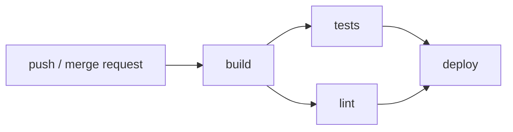

# Ollama: CI/CD на GitLab

Пет-проект, в котором вокруг [Ollama](https://github.com/ollama/ollama) собран полный CI/CD-пайплайн:
сборка Docker-образа, тесты, линт, публикация в **Docker Hub** и деплой в **Docker Swarm**.

Код самого Ollama — форк upstream (Go + C++/CMake), моя часть — вся обвязка: `.gitlab-ci.yml`,
`Dockerfile`, конфиг линтера и настройки пайплайна.

## Что есть в проекте

| Путь | Что это |
| --- | --- |
| `.gitlab-ci.yml` | Пайплайн: `build` → `test` → `deploy` |
| `Dockerfile` | Многостадийная сборка образа Ollama (CPU, CUDA 11/12/13, ROCm, Vulkan, JetPack) |
| `.dockerignore` | Что не тащить в контекст сборки |
| `.golangci.yaml` | Конфиг golangci-lint |
| `go.mod`, `go.sum` | Go 1.24, модуль `github.com/ollama/ollama` |
| `api/`, `server/`, `llm/`, `ml/`, `runner/`, `cmd/` | Исходники Ollama |
| `.github/workflows/` | Остались от upstream (GitHub Actions, в этом пайплайне не участвуют) |

## Пайплайн



Три стадии, джобы `interruptible`, при новом коммите в ту же ветку старый пайплайн отменяется
(`workflow: auto_cancel`).

### `build`

- Образ `docker:28` + сервис `docker:28-dind` (`DOCKER_HOST=docker:2375`, TLS выключен — только для dind внутри пайплайна).
- Логин в реестр из переменных `DOCKER_REGISTRY*`.
- Берёт официальный `ollama/ollama:0.12.8`, тегирует как
  `$DOCKER_REGISTRY/$DOCKER_REPOSITORY:ollama-$CI_COMMIT_SHORT_SHA` и пушит в Docker Hub.
- Тег привязан к короткому SHA коммита — у каждого коммита свой неизменяемый образ.

> `docker build` в этой джобе закомментирован: сейчас пайплайн не собирает образ из `Dockerfile`,
> а перетегирует официальный. Полная сборка Ollama (CUDA/ROCm/Vulkan) занимает десятки минут и
> требует мощного раннера, поэтому она вынесена в планы.

### `tests`

- Образ `golang:1.24`.
- `go test -coverprofile=coverage.out ./...` + `go tool cover -func` для отчёта.
- Покрытие парсится GitLab через `coverage: '/^total:\s+\(statements\)\s+(\d+\.\d+)%$/'` и показывается в MR.
- Кэш Go-модулей в `$CI_PROJECT_DIR/.cache/go-mod` по ключу ветки.

### `lint`

- `golangci-lint` v2.2.2, ставится из официального `install.sh`.
- `allow_failure: true` — замечания линтера не блокируют пайплайн (на форке upstream-кода их много).

### `deploy`

- Только для ветки `main` (`rules: !reference [.rules, main]`).
- Логин в реестр, затем `docker -H $DEPLOY_SERVER_ADDR stack deploy --with-registry-auth`
  со стеком `docker-swarm/stacks/ollama-deepseek.yaml` (сервис `ollama-deepseek`, модель `deepseek-r1:14b`).
- `--with-registry-auth` пробрасывает креды реестра в swarm, чтобы узлы смогли скачать образ.

## Переменные

Все значения задаются **в настройках проекта GitLab**: `Settings → CI/CD → Variables`.
В репозиторий они не попадают.

| Переменная | Пример | Зачем | Настройки |
| --- | --- | --- | --- |
| `DOCKER_REGISTRY` | `docker.io` | Адрес реестра (Docker Hub) | — |
| `DOCKER_REGISTRY_USER` | `lizoksorokina` | Логин в Docker Hub | — |
| `DOCKER_REGISTRY_PASSWORD` | `dckr_pat_***` | Access token Docker Hub | **Masked**, Protected |
| `DOCKER_REPOSITORY` | `lizoksorokina/ollama` | Репозиторий, куда пушится образ | — |
| `DEPLOY_SERVER_ADDR` | `tcp://10.0.0.10:2375` | Адрес Docker Swarm manager | **Masked**, Protected |

`DOCKER_IMAGE_TAG` руками не задаётся — собирается из `DOCKER_REGISTRY`, `DOCKER_REPOSITORY` и SHA коммита.

Пароль — именно **access token** (Docker Hub → Account settings → Security → New access token,
права Read & Write), а не пароль от аккаунта: токен можно отозвать, и он не всплывёт в логах.

## Что нужно, чтобы пайплайн заработал

1. **GitLab-проект** с этим репозиторием и `.gitlab-ci.yml` в корне.
2. **GitLab Runner** с docker-экзекьютором и `privileged = true` — без этого dind в джобе `build` не запустится.
3. **Репозиторий на Docker Hub** (публичный или приватный) + access token с правами на запись.
4. **Docker Swarm**: manager-нода, доступная с раннера по `DEPLOY_SERVER_ADDR`,
   и файл стека `docker-swarm/stacks/ollama-deepseek.yaml`.
5. **Переменные** из таблицы выше, добавленные в проект.
6. **GPU на нодах swarm** (NVIDIA driver + nvidia-container-toolkit), если модель запускается на GPU.

Порт Docker API (`2375`) лучше не открывать в интернет: правильнее поднять TLS (`2376`) или
пробросить доступ через VPN/SSH-туннель.

## Локальная проверка

```bash
# тесты и покрытие — как в CI
go test -coverprofile=coverage.out ./...
go tool cover -func=coverage.out

# сборка образа из Dockerfile
docker build -t ollama-local .

# запуск и проверка API
docker run -d --name ollama-local -p 11434:11434 ollama-local
curl http://localhost:11434/api/tags
```

Забрать образ, собранный пайплайном:

```bash
docker pull docker.io/<user>/<repo>:ollama-<short-sha>
```

Это тот же тег, что собирает джоба `build`: `<DOCKER_REGISTRY>/<DOCKER_REPOSITORY>:ollama-<sha>`.

## Что дальше

- Включить реальную сборку в `build` (кэш слоёв, buildx, `--cache-from`) вместо перетегирования.
- Добавить сканирование образа (Trivy) и проверку Dockerfile линтером (hadolint).
- Вынести общие куски пайплайна в `.gitlab/ci/*.yml` и переиспользовать через `include`.
- Развести окружения: staging на каждой ветке, production — только по тегу.

## Лицензия

Проект основан на [ollama/ollama](https://github.com/ollama/ollama) и распространяется под
Apache License 2.0 — см. [LICENSE](LICENSE).
